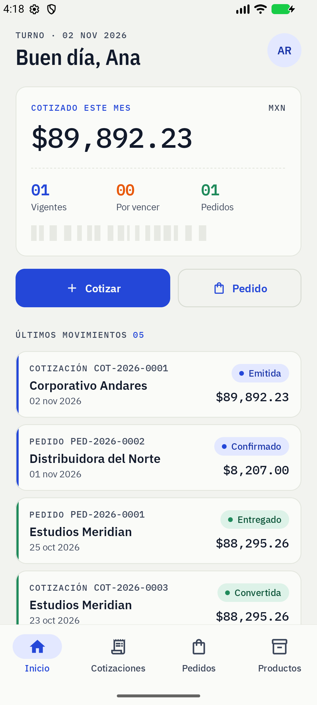
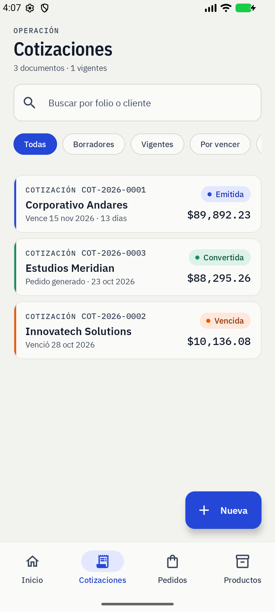
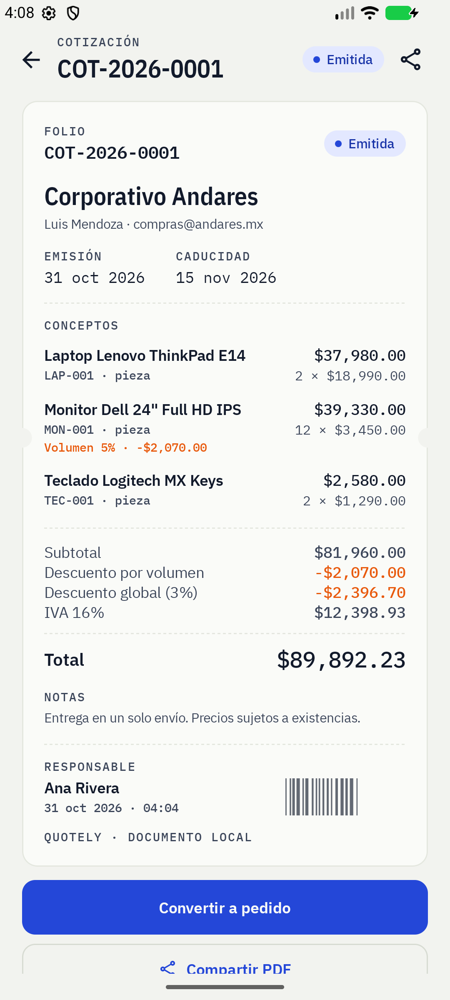
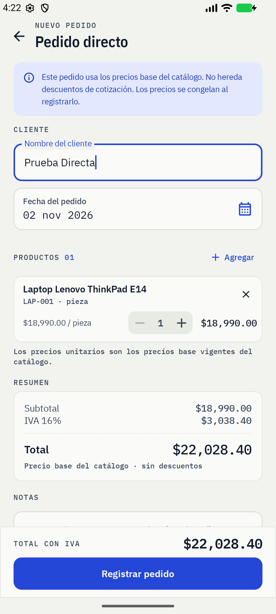
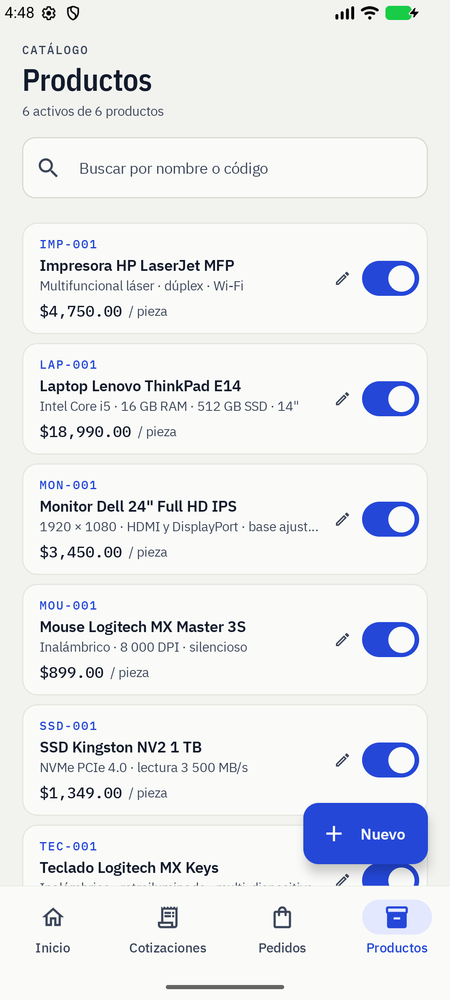
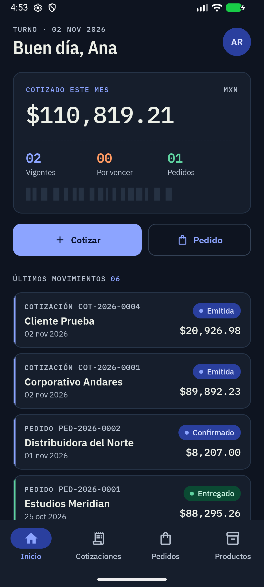

# Quotely

Aplicación Android nativa para registrar **cotizaciones y pedidos de productos de cómputo**, con precios congelados, descuentos por volumen y globales, IVA, vigencia, responsables y exportación de documentos y de la base de datos.

> Kotlin + Jetpack Compose + Room (SQLite). Sin backend, sin conexión y sin CI/CD: todo vive en el dispositivo.



---

## 1. Abrir el proyecto en Android Studio

1. Abre **Android Studio**.
2. `File → Open…` y selecciona la carpeta raíz:
   `C:\Users\Jdmm\desktop\Tarea_movil` (la que contiene `settings.gradle.kts`).
3. Espera la sincronización de Gradle. El proyecto incluye el **Gradle Wrapper** (`gradlew`, `gradlew.bat`), por lo que no necesitas instalar Gradle.
4. Verifica que el SDK de Android esté configurado. El archivo `local.properties` ya apunta a:
   `C:/Users/Jdmm/AppData/Local/Android/Sdk`
   Si abres el proyecto en otra máquina, Android Studio lo regenera.
5. Elige un emulador o dispositivo con **Android 8.0 (API 26) o superior** y pulsa **Run**.

### Compilar desde terminal

```powershell
.\gradlew.bat :app:assembleDebug
.\gradlew.bat :app:testDebugUnitTest
```

APK generado:

```
app/build/outputs/apk/debug/app-debug.apk
```

También se incluye una copia lista para instalar en `dist/quotely-1.0-debug.apk`:

```powershell
adb install -r dist/quotely-1.0-debug.apk
```

También se incluye un `gradlew` para macOS/Linux.

### Stack

| Pieza | Versión / decisión |
|---|---|
| Lenguaje | Kotlin 2.0.21 |
| UI | Jetpack Compose + Material 3 |
| Navegación | Navigation Compose |
| Persistencia | Room 2.6.1 sobre SQLite, esquema exportado |
| Sesión | DataStore Preferences |
| PDF | `android.graphics.pdf.PdfDocument` nativo + `FileProvider` |
| minSdk / targetSdk | 26 / 34 |
| Java | 17 (el entorno tiene JDK 21) |
| Arquitectura | MVVM + Repository, un solo módulo |

---

## 2. Credenciales y datos de ejemplo

En el primer arranque la base se siembra automáticamente.

| Rol | Usuario | Contraseña |
|---|---|---|
| Administrador | `admin` | `admin123` |
| Vendedor | `vendedor` | `vendedor123` |

Datos precargados:

- **2 responsables**: Ana Rivera (administradora) y Diego Salas (vendedor).
- **6 productos**: laptop, monitor, teclado, mouse, impresora y SSD, con precios base en MXN.
- **3 cotizaciones**:
  - `COT-XXXX-0001` · Corporativo Andares · emitida y vigente, con descuento por volumen y global.
  - `COT-XXXX-0002` · Innovatech Solutions · emitida pero **vencida** (sirve para probar el bloqueo de conversión).
  - `COT-XXXX-0003` · Estudios Meridian · **convertida** en pedido.
- **2 pedidos**:
  - `PED-XXXX-0001` · Estudios Meridian · creado desde cotización, precios conservados.
  - `PED-XXXX-0002` · Distribuidora del Norte · pedido directo con precios base.

Las fechas se generan relativas al día de instalación para que la demo siempre tenga una cotización vigente del mes actual.

> Para volver a los datos iniciales: borra los datos de la app desde Android (`Ajustes del sistema → Apps → Quotely → Almacenamiento → Borrar datos`) o ejecuta `adb shell pm clear com.quotely.app`.

---

## 3. Flujos de la aplicación

### Inicio de sesión y responsable

- El acceso es local. Cada cotización y pedido guarda el `responsableId` del usuario autenticado.
- La sesión se conserva con DataStore; al cerrar y abrir la app se mantiene.
- Las contraseñas se guardan con **PBKDF2-HMAC-SHA256** (120 000 iteraciones, salt aleatorio de 16 bytes).
- El administrador puede crear responsables, cambiar nombre/usuario/rol, resetear contraseña y activar/desactivar accesos. No puede desactivar su propio acceso.

### Cotizaciones

1. **Nueva cotización**: cliente, contacto opcional, fecha de emisión y caducidad (por defecto +15 días).
2. Se agregan productos del catálogo activo con cantidad.
3. El descuento por volumen se aplica **automáticamente por línea**.
4. Se puede aplicar un **descuento global**: sin descuento, porcentaje o monto fijo.
5. Se guarda como **borrador** o se **emite**.
6. Solo los borradores se pueden editar. Una cotización emitida ya no se modifica, pero puede anularse.
7. El detalle permite **compartir el PDF** y, si está vigente, **convertirla en pedido**.

### Pedidos

- **Pedido directo**: se crea sin cotización. Usa el **precio base** actual del catálogo y **no** hereda descuentos de cotización.
- **Pedido desde cotización**: se crea desde el detalle de una cotización **emitida y vigente**. Copia precios unitarios, cantidades, descuentos y totales exactamente como están guardados en la cotización; después marca la cotización como **CONVERTIDA**. La base impide más de un pedido por cotización con un índice único.
- Si la cotización está vencida, la interfaz no ofrece la conversión y el repositorio también la bloquea.
- Estados del pedido: `PENDIENTE → CONFIRMADO → ENTREGADO`, con cancelación desde pendiente o confirmado. Un pedido entregado o cancelado ya no cambia.
- El pedido directo se registra en estado `PENDIENTE`; el pedido desde cotización también nace `PENDIENTE`.

### Catálogo y ajustes

- CRUD de productos con código único, nombre, descripción, precio base, unidad y activo/inactivo.
- Los productos inactivos no aparecen al crear documentos, pero los documentos históricos conservan su descripción y precio.
- **Ajustes** muestra al responsable, las reglas de cálculo, la base de datos, exportación y cierre de sesión.
- Solo el rol administrador ve la entrada a **Responsables**.

---

## 4. Reglas de negocio y cálculo

### Precios congelados

Cada línea de cotización guarda una **copia** de código, descripción, unidad, precio unitario, cantidad, porcentaje de descuento de volumen, descuento e importe. Los pedidos copian esas mismas líneas. Por eso, cambiar el precio de un producto en el catálogo **no altera** documentos ya guardados.

### Descuento por volumen (solo cotizaciones)

Se aplica por producto según la cantidad:

| Cantidad | Descuento |
|---:|---:|
| 1–9 | 0 % |
| 10–24 | 5 % |
| 25–49 | 10 % |
| 50+ | 15 % |

Los tramos están centralizados en `domain/Modelos.kt` (`PricingConfig.tramosVolumen`) para poder ajustarlos sin tocar la UI.

### Descuento global

- **Porcentaje**: 0–100 % sobre el subtotal después del descuento por volumen.
- **Monto fijo**: se limita automáticamente al subtotal después del descuento por volumen (no puede dejar importes negativos).
- En pedidos directos no se aplican descuentos.

### Totales

```
subtotal            = Σ (precio unitario × cantidad)
descuento volumen   = Σ (base de línea × % tramo)
después de volumen  = subtotal − descuento volumen
descuento global    = % o monto, topado a “después de volumen”
base gravable       = después de volumen − descuento global
IVA 16 %            = base gravable × 0.16
TOTAL               = base gravable + IVA
```

Todos los importes se redondean a 2 decimales con `BigDecimal.HALF_UP`.

### Vigencia y estados de cotización

- La caducidad no puede ser anterior a la emisión.
- La cotización vence al terminar el día de caducidad; el mismo día todavía se puede convertir.
- Estados persistidos: `BORRADOR`, `EMITIDA`, `CONVERTIDA`, `ANULADA`.
- `VENCIDA` se calcula al vuelo (`estado == EMITIDA && caducidad < hoy`), no se guarda.
- No se puede convertir una cotización vencida, anulada o ya convertida.

### Folios

- `COT-AAAA-####` para cotizaciones.
- `PED-AAAA-####` para pedidos.
- Secuencia por año, generada dentro de una transacción de Room.

---

## 5. Diseño de interfaz

La dirección visual se documenta en [`docs/DISENO.md`](docs/DISENO.md): **“Mostrador técnico”**, inspirada en etiquetas de especificaciones de hardware y tickets de punto de venta.

- Paleta: papel frío, tinta azul-negra, cobalto de señalización, naranja de etiqueta y verde de éxito.
- Tipografía **IBM Plex**: Sans Condensed para titulares, Sans para cuerpo y Mono para folios, fechas e importes. Las fuentes están incluidas en `res/font` bajo licencia OFL (`third_party/IBMPlex-OFL.txt`).
- Firma visual: tarjetas de documento tipo ticket, código de barras determinístico por folio y sello de estado.
- Modo claro y oscuro; la app fuerza español (`es-MX`) para que también el selector de fecha de Material 3 aparezca en español.

Capturas: [`docs/capturas`](docs/capturas).

| Inicio | Cotizaciones | Detalle de cotización |
|---|---|---|
|  |  |  |

| Pedido directo | Productos | Modo oscuro |
|---|---|---|
|  |  |  |


---

## 6. Base de datos y cómo gestionarla

### Motor

**SQLite** mediante **Room**. Archivo:

```
/data/data/com.quotely.app/databases/quotely.db
```

Esquema actual: **versión 2** (incluye migración `1 → 2` que agrega el tipo y valor del descuento global a `pedidos`).

Tablas:

| Tabla | Contenido |
|---|---|
| `responsables` | usuarios, hash, salt, rol, activo |
| `productos` | catálogo y precio base |
| `cotizaciones` | cabecera, fechas, estado y totales |
| `cotizacion_items` | líneas con precio congelado |
| `pedidos` | cabecera, origen, cotización de origen y totales |
| `pedido_items` | líneas copiadas de la cotización o precio base |

El esquema exportado por Room está en:

```
app/schemas/com.quotely.app.data.local.QuotelyDatabase/2.json
```

y una versión legible en SQL en [`docs/esquema.sql`](docs/esquema.sql).

### Opción A · Android Studio Database Inspector

1. Ejecuta la app en modo **debug**.
2. `View → Tool Windows → App Inspection`.
3. Pestaña **Database Inspector** → selecciona `com.quotely.app` → `quotely.db`.
4. Puedes expandir tablas, editar celdas y abrir **New Query** para ejecutar SQL en vivo.

### Opción B · Exportar desde la app (recomendada para terminal)

1. `Ajustes → Base de datos → Exportar base de datos (.db)`.
2. La app hace `PRAGMA wal_checkpoint(FULL)`, copia el archivo al caché y abre el share sheet.
3. Comparte el `.db` a Drive/Archivos o extráelo por ADB:

```powershell
$adb = "$env:LOCALAPPDATA\Android\Sdk\platform-tools\adb.exe"
& $adb shell run-as com.quotely.app ls cache
cmd /c "%LOCALAPPDATA%\Android\Sdk\platform-tools\adb.exe exec-out run-as com.quotely.app cat cache/quotely_20260101_120000.db > quotely.db"
```

Abre `quotely.db` con **DB Browser for SQLite** o **SQLiteStudio** (ambos gratuitos): puedes consultar y editar.

### Opción C · Terminal (build debug)

Copia la base principal (sin el exportador). Si la app está abierta, usa el exportador para incluir el WAL:

```powershell
$adb = "$env:LOCALAPPDATA\Android\Sdk\platform-tools\adb.exe"
cmd /c "%LOCALAPPDATA%\Android\Sdk\platform-tools\adb.exe exec-out run-as com.quotely.app cat databases/quotely.db > quotely.db"
```

> `run-as` funciona porque el APK de debug es depurable. En un build release necesitarías root o una copia de seguridad.

### Consultas útiles

```sql
-- Cotizaciones recientes
SELECT folio, cliente, estado, total FROM cotizaciones ORDER BY id DESC;

-- Detalle de una cotización
SELECT c.folio, i.descripcion, i.cantidad, i.precioUnitario,
       i.descuentoVolumenPct, i.importe
FROM cotizaciones c
JOIN cotizacion_items i ON i.cotizacionId = c.id
WHERE c.folio = 'COT-2026-0001';

-- Pedidos y su origen
SELECT folio, origen, cotizacionId, estado, total
FROM pedidos ORDER BY id DESC;

-- Responsables activos
SELECT nombre, usuario, rol FROM responsables WHERE activo = 1;
```

---

## 7. Pruebas y verificación

```powershell
.\gradlew.bat :app:testDebugUnitTest
.\gradlew.bat :app:assembleDebug
```

Las pruebas de `app/src/test/java/com/quotely/app/PricingTest.kt` cubren:

- límites de los tramos de volumen (9/10/24/25/49/50),
- cotización sin descuentos + IVA,
- combinación de descuento por volumen y global porcentual,
- tope del descuento global por monto,
- pedido directo sin descuentos,
- redondeo a 2 decimales,
- vencimiento y bloqueo de conversión.

También se ejecutó la app en un emulador (`Medium_Phone_API_37.0`) verificando: login, alta de cotización, descuento global, emisión, conversión a pedido, pedido directo, PDF compartido, exportación `.db`, catálogo y formulario de responsables.

---

## 8. Estructura del proyecto

```
Tarea_movil/
├─ settings.gradle.kts
├─ build.gradle.kts
├─ gradle.properties
├─ gradle/wrapper/ + gradlew + gradlew.bat
├─ local.properties                 # ruta del SDK local
├─ app/
│  ├─ build.gradle.kts
│  ├─ schemas/                      # esquema Room exportado (v1 y v2)
│  └─ src/
│     ├─ main/
│     │  ├─ AndroidManifest.xml
│     │  ├─ res/                    # fuentes IBM Plex, tema, iconos, FileProvider
│     │  └─ java/com/quotely/app/
│     │     ├─ MainActivity.kt
│     │     ├─ QuotelyApp.kt        # Application + AppContainer
│     │     ├─ data/
│     │     │  ├─ local/            # entidades, DAOs, base Room, relaciones
│     │     │  ├─ repository/       # Auth, Productos, Cotizaciones, Pedidos
│     │     │  └─ seed/             # datos iniciales
│     │     ├─ domain/              # precios, descuentos, estados, totales
│     │     ├─ ui/
│     │     │  ├─ navigation/       # rutas y scaffold con barra inferior
│     │     │  ├─ screens/          # login, inicio, cotizaciones, pedidos, etc.
│     │     │  ├─ components/       # ticket, barcode, campos, totales
│     │     │  ├─ theme/            # color, tipografía, tema claro/oscuro
│     │     │  └─ viewmodel/        # estado y acciones de cada pantalla
│     │     └─ util/                # formato, PDF, hash, exportador de BD
│     └─ test/                      # pruebas JVM de cálculo y vigencia
├─ docs/
│  ├─ DISENO.md
│  ├─ esquema.sql
│  └─ capturas/
└─ third_party/IBMPlex-OFL.txt
```

---

## 9. Decisiones y límites

- **Local y sin backend**: no hay sincronización entre dispositivos ni autenticación remota.
- **Moneda MXN** con formato `$1,234.56`; el IVA es fijo del **16 %**.
- **Roles simples**: todos los usuarios autenticados pueden cotizar, pedir y editar catálogo; solo el administrador gestiona responsables. No se pidió un sistema de permisos más granular.
- **Sin CI/CD**: se entrega un proyecto que se abre, compila y ejecuta desde Android Studio.
- **Datos semilla solo en el primer arranque**; si ya existen responsables o productos, no se vuelven a insertar.
- La app fija el locale `es-MX` para toda la interfaz y el selector de fecha, independientemente del idioma del sistema.
- El PDF se genera localmente y se comparte con el share sheet de Android; no se firma digitalmente.
- Para varios dispositivos o trabajo en red habría que sustituir Room por un backend (Firebase/Supabase/API propia) y agregar sincronización.

---

## 10. Licencias

- Código del proyecto: uso académico.
- IBM Plex Sans, IBM Plex Sans Condensed e IBM Plex Mono: SIL Open Font License 1.1. Texto completo en `third_party/IBMPlex-OFL.txt`.
- Iconografía: Material Icons (Apache 2.0), incluidas con Compose Material.
